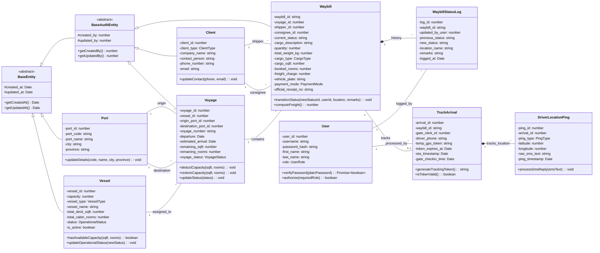

# Trans-Track System - Enterprise Inheritance & Interface Class Diagram

This document provides the fully corrected and verified object-oriented inheritance and interface implementation hierarchy for the Trans-Track PERN stack architecture, mapping repository patterns, base entity models, specialized domain objects, and strict relational associations.

