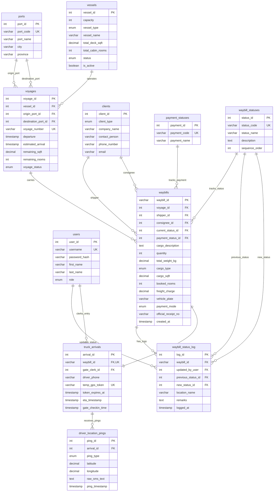

# Trans-Track System - Entity Relationship Diagram (ERD) Architecture

This document provides the complete Entity Relationship Diagram (ERD) representation and detailed schema documentation for the Trans-Track system, derived directly from the relational database specifications in `/Docs/trans-track erd explanation.pdf`.

## 1. High-Level ERD Overview (Mermaid.js Entity Relationship Diagram)

---

## 2. Relational Schema & Entity Specifications

### Master Reference Entities
- **ports**: Stores port terminals (`ILG` for Iligan City, `CEB` for Cebu City).
- **vessels**: Defines physical fleet specs, deck square footage (`total_deck_sqft`), and cabin room counts (`total_cabin_rooms`).
- **payment_statuses**: Standard payment codes (`UNPAID`, `PAID`, `PARTIAL`, `REFUNDED`).
- **waybill_statuses**: Controls tracking progress bars through ordered sequence steps (1 to 7: `BOOKED` through `DELIVERED`).

### Core Operational Entities
- **voyages**: Scheduled trips serving as the target for the **Auto-Deduction Engine** (automatically deducting `cargo_sqft` and `booked_rooms` from `remaining_sqft` and `remaining_rooms`).
- **clients**: Master directory for shippers and consignees.
- **users**: Internal staff accounts (`GATE_CLERK`, `OIC_LOADMASTER`, `EXECUTIVE`, `ADMIN`).
- **waybills**: Central cargo booking and staging entity linking voyages, clients, statuses, and dynamic freight charges.

### Execution & Telemetry Tracking
- **waybill_status_log**: Immutable audit trail tracking chronological state transitions.
- **truck_arrivals**: Handles gate check-ins, enforcing the **Single-Entry Gate** constraint (`waybill_id` is UNIQUE) and housing temporary GPS tracking tokens (`temp_gps_token`).
- **driver_location_pings**: Stores browser GPS pings or Two-Way SMS fallback replies (`ping_type`: `GPS_LINK`, `SMS_FALLBACK`).
